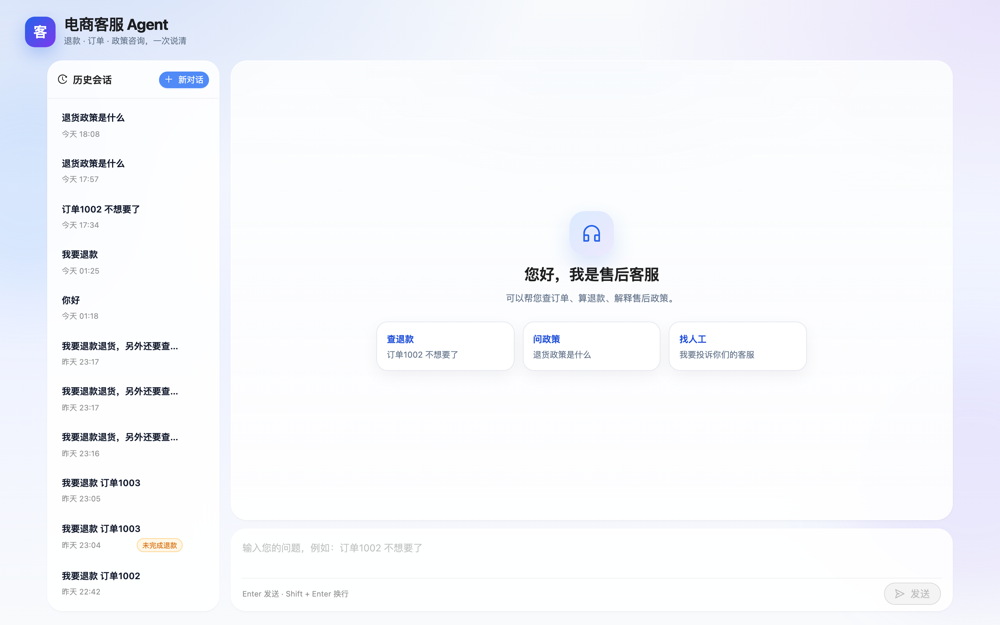

# 电商客服 Agent

面向消费者的售后客服（C 端），核心是把退费核算从人工翻合同变成可核对、可追溯的自动计算。

> **在线体验**：<https://ecom.da-dong.com>
>
> **评测结果**：30 条盲测 correctness 0.783，修复退款窗口与流程问题后同批回归 0.987；
> 44 条端到端评测 correctness 0.998（本地脚本）/ 1.0（EvalFlow 平台全量 Judge）。
> 线上保护：20 次/分限流 + 每日 5 元预算；3 并发完整响应 P95 1.58s。

> Ch01–Ch08 已在本地跑通；Ch09 离线数据飞轮已完成闭环，
> 见 [ch09-flywheel-acceptance.md](docs/reports/ch09-flywheel-acceptance.md)。
> 设计文档见 [docs/design/](docs/design/)。

## 快速开始

### 1. 准备环境

- Python 3.12 + [uv](https://docs.astral.sh/uv/)
- Node 20+
- Chroma（Docker，8000）
- Ollama + `bge-m3`（11434）

端口与环境变量见 [local-env.md](docs/reports/local-env.md)。

```bash
cp .env.example .env          # 填 CHAT_* / EMBED_* 配置
uv sync
```

### 2. 建库与迁移

```bash
uv run python scripts/init_db.py
uv run python scripts/seed.py

# 老库补齐 Ch08 的 reply_to_client_message_id + 唯一部分索引
uv run python scripts/migrate_ch08.py --db data/app.db
uv run python scripts/migrate_ch08.py --db data/eval.db
```

### 3. 启动后端

```bash
uv run uvicorn app.main:app --reload --port 8090
```

健康检查：`curl http://127.0.0.1:8090/api/health`

### 4. 启动前端

```bash
cd client
npm install
npm run dev
```

打开 <http://127.0.0.1:5190>。Vite 已把 `/api` 代理到 `127.0.0.1:8090`。

## 界面



退款进度与知识问答引用见
[ch08-acceptance.md §3.1](docs/reports/ch08-acceptance.md#31-界面截图)。

## 验证

```bash
uv run pytest -q          # 后端：1084 passed, 10 skipped
uv run ruff check .       # 通过

cd client
npm run typecheck         # 通过
npm test                  # 11 files, 78 tests passed
npm run build             # 通过
```

四场景与断流验收见 [ch08-acceptance.md](docs/reports/ch08-acceptance.md)。

## 进度

| 章节 | 内容 | 状态 |
|---|---|---|
| Ch01 | 数据地基：10 表 / seed / 越权校验 | ✅ |
| Ch02 | 主流程骨架：主图 + 意图 + 知识出口 | ✅ |
| Ch03 | C 出口：退款状态机与金额计算 | ✅ |
| Ch04 | B 出口：订单 / 物流 / 库存查询 | ✅ |
| Ch05 | 多轮：窗口 / 摘要 / park / ReAct | ✅ |
| Ch06 | 安全：注入防御 / 输出检查 | ✅ |
| Ch07 | 评测：44 条评测集 / 阈值 / 退款困难组 | ✅ |
| Ch08 | 前端：聊天 + 进度 + 动作 + 历史 + 断流 | ✅（三张截图已补；录屏待补） |
| Ch09 | 数据飞轮（离线模拟 + 审核 UI） | ✅ 完成 |

## 架构

```
意图分流（12 意图 / 5 出口）
  ├─ A 知识：检索 → 证据闸 → 生成
  ├─ B 数据：参数校验 → 工具 → 结果校验
  ├─ C 规则：8 状态流水线（抽取 → 校验 → 查数 → 计算 → 合规 → 应答）
  ├─ D 转人工
  └─ E 兜底
```

前端：React + Vite + TypeScript + antd；SSE 帧 reducer；断流采用 C2-lite
（历史对账 + 同一 `client_message_id` 回放/重试）。

## 设计取舍

- **金额由代码算，模型只复述**：合同规则有 6 种组合，模型算不出可复现结果。
- **追问用独立状态而非 interrupt**：可单测、图上可见。
- **守卫失败按不通过处理（fail-closed）**：判断不了 ≠ 通过。
- **数据类问题不进向量检索**：能查库的不检索。
- **先落库再展示**：用户看到的回答一定已保存；保存失败就不展示。

## 局限

- 无真实用户，数据为合成；未接支付与真实物流，退款为模拟。
- 没有工单闭环、真实坐席队列、登录鉴权。
- 评测集规模有限；held-out 不是严格盲测。
- Ch09 飞轮是离线模拟，不是线上自动飞轮。

## 文档入口

| 想了解 | 先看 |
|---|---|
| 整体复习 / 面试 | [project-review.md](docs/reports/project-review.md) |
| Ch08 验收 | [ch08-acceptance.md](docs/reports/ch08-acceptance.md) |
| 逐任务改了什么 | [00-change-log-overview.md](docs/reports/00-change-log-overview.md) |
| 待做与已知边界 | [todo.md](docs/reports/todo.md) |
| 本地环境 | [local-env.md](docs/reports/local-env.md) |
| 简历措辞 | [resume-positioning.md](docs/reports/resume-positioning.md) |

## License

待定
