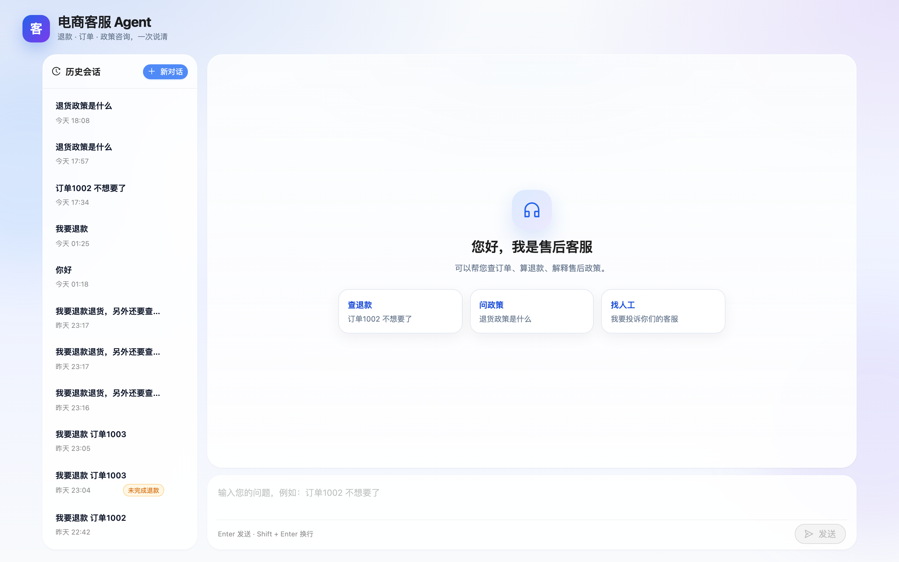
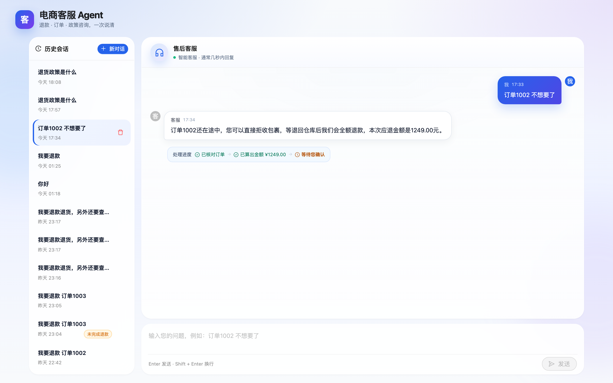
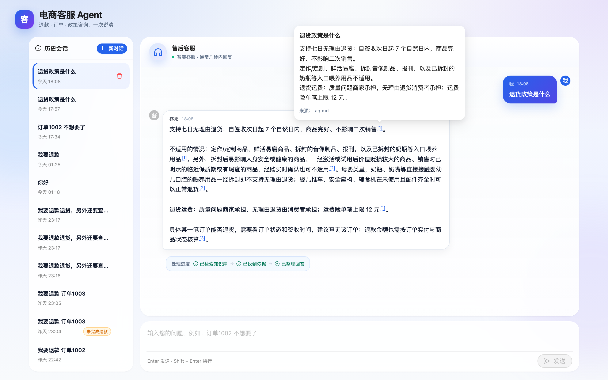

# Ch08 前端验收

> 日期：2026-11-16 ～ 2026-11-17
> 环境：macOS / Python 3.12 / Node 20.20.2 / 后端 8090 / 前端 5190 /
> Chroma 8000 / Ollama 11434 可用。
> 结论：**功能、回归、断流演练与界面截图通过；录屏待补。**

---

## 1. 验收范围

Ch08 的目标是把 Ch01–Ch07 的后端能力做成可演示的 C 端界面：

- 聊天窗 + SSE 帧渲染；
- 进度面板（核对中 / 已算出 / 待确认）；
- 动作卡片（选订单 / 选型号 / 选规格 / 继续流程 / 转人工）；
- 会话列表与历史恢复；
- C2-lite 断流重连；
- 支撑上述能力的后端契约（回放 / 历史 / progress / 转人工）。

不在范围：工单闭环、真实坐席队列、token 级流式、B 端工作台。

---

## 2. 回归结果

### 2.1 后端

```bash
uv run pytest -q
# 1084 passed, 10 skipped in 41.62s

uv run ruff check .
# All checks passed!
```

新增/相关覆盖：

| 能力 | 测试 |
|---|---|
| 迁移幂等 | `tests/db/test_migrate_ch08.py` |
| 唯一回复索引 | `tests/db/test_repo_message.py` |
| 保存失败 fail-closed | `tests/api/test_chat_sse.py` |
| 重试回放不重复 | `tests/api/test_chat_sse.py` |
| 历史接口归属/白名单 | `tests/api/test_conversations_api.py` |
| progress 帧 | `tests/core/test_progress.py`、`tests/api/test_chat_sse.py` |
| 转人工短路 | `tests/api/test_chat_sse.py` |

### 2.2 前端

```bash
cd client
npm run typecheck   # 通过
npm test            # 11 files, 78 tests passed
npm run build       # 通过；dist JS 870.53 kB（gzip 274.55 kB）
```

构建仍有 antd 超过 500 kB 的提示；Ch08 不做 code split，留 P9 交付前评估。

---

## 3. 四个演示场景

以下用 `POST /api/chat` 的真实 SSE 输出验证；界面截图见 §3.1，录屏待补。

### 场景 1：正常退费

输入：`订单1002 不想要了`（conversation 23）

| 帧 | 结果 |
|---|---|
| `ack` | `conversation_id=23`、`user_message_id=97` |
| `route` | `rules` / `退款申请` |
| `progress` | `checking_order done` |
| `progress` | `amount_ready done`，`amount=124900` |
| `progress` | `waiting_confirm waiting`，`amount=124900` |
| `delta` | 拒收包裹、全额退款、金额 `1249.00` |
| `done` | `message_id=98` |

结论：路由正确；金额只出现一次；三态进度完整。

> 验收中发现并修复：真实规则图的 `order_snapshot` 在 `validate` 写入，原
> `node_frame` 只认 `query_data` 的 update，导致 live 输出缺少 `checking_order`。
> 现在 `validate` / `query_data` 都看“本节点 update + 已累积 state”，并补了测试。

### 场景 2：转人工

输入：`我要投诉你们的客服`（conversation 25）

| 帧 | 结果 |
|---|---|
| `route` | `human` / `投诉` |
| `progress` | `handoff waiting` |
| `delta` | “已为您转接人工客服，请稍候……” |
| `actions` | `[{"type":"transfer_human"}]` |
| `done` | `message_id=106` |

结论：转人工结构化动作正确；不建工单。

> 说明：计划里原示例“用了一下，不太确定算不算用过，能退吗”在真实路由中进入
> `rules` 并追问退款原因，不是转人工。验收改用投诉样本。

### 场景 3：知识问答

输入：`退货政策是什么`（conversation 26）

| 帧 | 结果 |
|---|---|
| `route` | `knowledge` / `政策问答` |
| `progress` | `retrieving` → `evidence_ready` → `answering` |
| `delta` | 七日无理由、例外商品、退货运费 |
| `citations` | `faq#退货政策是什么`、`returns#不适用无理由退货的商品`、`returns#本文档不提供什么` |
| `done` | `message_id=108` |

结论：检索、证据、回答、引用完整；引用标题可在前端角标查看。

### 场景 4：离开再回来

输入序列（conversation 27）：

| 轮次 | 输入 | 结果 |
|---|---|---|
| 1 | `我要退款` | `rules`；`waiting_info(order_id)`；列 3 笔订单 |
| 2 | `退货政策是什么` | `knowledge` 正常回答；结尾提示“还有一笔未完成的退款申请”；`actions=[resume_flow]` |
| 3 | `继续退费`（带 `selected_action`） | `rules`、`resumed=true`；未完成槽位继续问 `order_id` |
| 4 | `1002` | `rules`、`resumed=true`；继续问 `reason_code` |
| 5 | `不想要了` | `checking_order` → `amount_ready(124900)` → `waiting_confirm`；完成退款 |

结论：park 提示、结构化 resume、跨轮槽位接回都正常；已提供的槽位不重复问，
缺失槽位继续补齐。

### 3.1 界面截图

三张截图统一为 1440×900 CSS 像素 / 2× DPR（2880×1800）：

| 截图 | 内容 |
|---|---|
| [主界面](../assets/ch08/01-main.png) | 欢迎页、示例问题、历史会话、输入框 |
| [退款进度](../assets/ch08/02-refund-progress.png) | 已核对订单 → 已算出 ¥1249.00 → 等待确认；等待态用时钟，不转圈 |
| [知识问答引用](../assets/ch08/03-knowledge-citation.png) | 回答引用 `[1]` 与来源浮层（`faq.md`） |







---

## 4. 断流与回放演练

### 4.1 同一 `client_message_id` 重放

完成场景 1 后，用同一个 `client_message_id`（`cm-1794826033-2`）再次请求：

```text
ack(conversation_id=23, user_message_id=97)
route(rules)
progress(waiting_confirm, amount=124900)
delta(已存回答，逐字一致)
done(message_id=98)
```

数据库核对：

```text
conversation 23: 2 messages
- user id=97   client_message_id=cm-1794826033-2
- assistant id=98 reply_to_client_message_id=cm-1794826033-2
```

结论：没有新增 user / assistant；回放内容与第一次一致。

### 4.2 历史恢复

`GET /api/conversations/23/messages` 返回：

- user：`client_message_id`；
- assistant：`status=completed`、`reply_to_client_message_id`；
- `meta.route`、`meta.actions`、`meta.signals.amount`；
- 不返回 tool 消息、`trace_id`、`draft`、订单快照、内部置信度。

前端 `buildHistoryState` 可恢复：
消息、引用、动作卡片、金额、`pending_question`、`resumed`。

### 4.3 浏览器 DevTools 断流

命令行重放已验证服务端不重复；浏览器侧已完成人工演练并确认：

- 日期：2026-11-17
- 环境：macOS / Chrome / 后端 8090 / 前端 5190
- 会话：57
- 操作：
  1. 发送「订单1002 不想要了」；
  2. 生成过程中中断 SSE（停止后端）；
  3. 恢复后端，点击「继续」；
  4. 刷新页面。
- 实际：
  - 断流后出现错误提示和「继续」按钮；
  - 点击后回答正常返回，只有一条助手气泡；
  - 原用户消息只有一条，没有重复发送；
  - 刷新后历史仍为一问一答，没有重复，按钮不再出现。
- 数据库核对：
  - user id=253，`client_message_id=0909333f-2e8f-4be6-859b-6ded9a676949`；
  - assistant id=254，`reply_to_client_message_id=0909333f-2e8f-4be6-859b-6ded9a676949`，
    `status=completed`；
  - 重复用户消息 / 重复助手回复 / 孤儿助手回复均为 0。
- 结论：通过。

---

## 5. 已知边界

| 边界 | 说明 |
|---|---|
| `ack` 丢失 | 前端没有 `conversation_id`，继续会新建会话；单会话 UI 不展示孤儿会话；见 TODO P3 #8 |
| 原请求仍在跑 | 继续会收到 429 `busy`；前端提示并冷却 5 秒，不自动重试 |
| token 级流式 | 不做；`delta` 是整段一帧，进度靠 `progress` 帧 |
| 工单 | 不做；转人工只给固定话术与动作，没有工单/坐席队列 |
| 浏览器截图/录屏 | 三张界面截图已补（`docs/assets/ch08/`）；2 分钟录屏待补 |
| 构建体积 | antd 导致 870.53 kB；P9 交付前再评估 code split |

---

## 6. TODO 对应

| 项 | 状态 |
|---|---|
| P0-1 四个开放问题 | ✅ 已关闭 |
| P0-2 后端 8 项契约 | ✅ 已关闭 |
| P3 #2 无 ALTER 迁移 | ✅ 已关闭；README 已补迁移命令 |
| P3 #7 schema 单向索引检查 | ✅ 已关闭 |
| P3 #8 `ack` 丢失边界 | 保留；跨会话去重不在 Ch08 范围 |
| P4 #8 数据飞轮 | 保留；见 Ch09 计划 |
| P5 截图/录屏/README 定稿 | README 已更新；三张截图已补；录屏仍待补 |

---

## 7. 复现命令

```bash
# 后端
uv sync
uv run python scripts/init_db.py
uv run python scripts/seed.py
uv run python scripts/migrate_ch08.py --db data/app.db
uv run python scripts/migrate_ch08.py --db data/eval.db
uv run uvicorn app.main:app --reload --port 8090

# 前端
cd client
npm install
npm run dev

# 回归
uv run pytest -q
uv run ruff check .
cd client && npm run typecheck && npm test && npm run build
```
