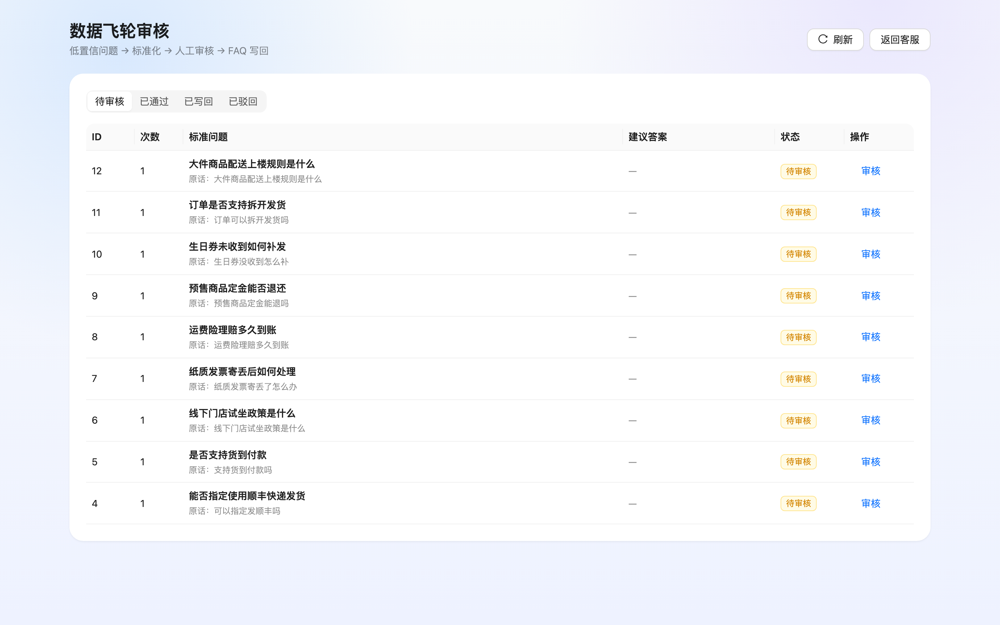
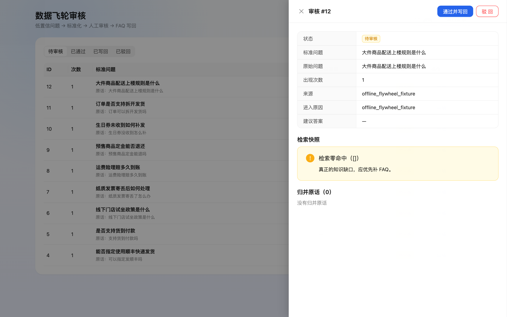
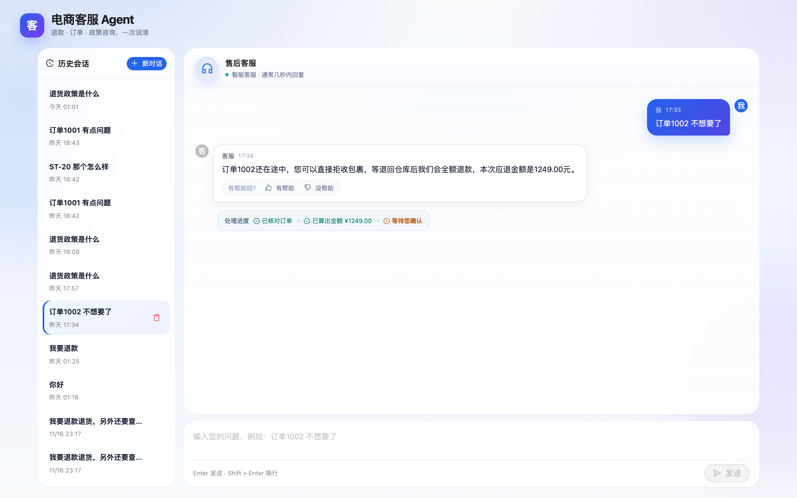

# Ch09 数据飞轮验收（离线模拟）

> 日期：2026-11-18
> 环境：macOS / Python 3.12 / Chroma 8000 / Ollama 11434 / DeepSeek `deepseek-chat`
> 结论：**离线最小闭环通过。** 12 条 badcase 全部完成
> 落池 → 标准化 → 审核 → FAQ 写回 → 检索命中；补库前后指标上升，
> 44 条确定性回归 44/44。
>
> **边界：本报告是离线模拟飞轮，没有真实用户流量；12 条答案是为演示人工
> 补写的合成答案，不代表真实平台政策。**

---

## 1. 验收范围

| 能力 | 状态 | 证据 |
|---|---|---|
| 低置信问题落池 | ✅ | `low_conf_questions`；已有 `weak_fallback`/feedback/rule_conflict 入口 |
| 标准化 + 查重 | ✅ | Task 2；12 条 fixture 生成 12 条 canonical |
| 人工审核 | ✅ | Task 3；approve/reject 状态机、CLI/API |
| FAQ 写回 + 向量化 | ✅ | Task 4；`faq-*` chunk 进入 Chroma |
| 检索命中 | ✅ | 补库后 badcase citation_hit 12/12 |
| 补库前后评测 | ✅ | 本报告；before/after 同 fixture、同 dataset_hash |
| 点踩 / 规则冲突入口 | ✅ | Task 5；API、C 端 👍/👎、compliance 落池 |
| 审核 UI | ✅ 可选已做 | `/#review`；队列、详情、通过/驳回、重试同步 |

不做：自动写回、实时入队、线上用户反馈闭环、模型微调、多级审批。

### 1.1 审核 UI

访问 `/#review`（需 `ENABLE_REVIEW_API=true`）：





C 端助手气泡下的反馈入口：



---

## 2. 数据与口径

| 项 | 值 |
|---|---|
| badcase | 12 条（知识库未覆盖的售后政策问题） |
| out_of_kb | 10 条（明确不在知识库/商品范围） |
| fixture | `data/eval/flywheel_badcases.yaml` |
| dataset_hash | `fca8f2d1fd4b`（before/after 相同） |
| 答案来源 | 人工为演示补写，**不是真实平台政策** |
| before 库 | 静态语料 57 chunk，无 FAQ，`kb_version=80bd26573951` |
| after 库 | 静态语料 + 12 条 FAQ = 69 chunk，`kb_version=865da1a0b66e` |

指标定义：

- `hit@3`：前 3 条召回 chunk 中，是否包含任一期望关键词；
- `recall`：答案中出现了多少比例的期望关键词；
- `citation_hit`：回答引用中是否出现 `faq-*`；
- `refusal_rate`：库外题走 human / fallback / transfer / 明确拒答的比例。

---

## 3. 补库前后结果

同一份 fixture、同一个 `dataset_hash`，只改变知识库：

| 指标 | before | after | 变化 |
|---|---:|---:|---:|
| badcase hit@3 | 0.500（6/12） | **1.000（12/12）** | +0.500 |
| answer recall | 0.667 | **0.958** | +0.292 |
| FAQ citation_hit | 0.000（0/12） | **1.000（12/12）** | +1.000 |
| out_of_kb refusal_rate | 0.700（7/10） | **0.800（8/10）** | +0.100 |
| kb_version | `80bd26573951` | `865da1a0b66e` | 已变化 |

原始报告：

- [before JSON](./ch09-flywheel-before.json) / [before Markdown](./ch09-flywheel-before.md)
- [after JSON](./ch09-flywheel-after.json) / [after Markdown](./ch09-flywheel-after.md)

### 3.1 12 条 badcase

| id | 问题 | before hit@3 | after hit@3 | after recall | after citation |
|---|---|---|---|---|---|
| F01 | 价保规则是什么 | ✅ | ✅ | 1.00 | ✅ |
| F02 | 支持以旧换新吗 | ❌ | ✅ | 1.00 | ✅ |
| F03 | 修改收货地址的规则是什么 | ✅ | ✅ | 1.00 | ✅ |
| F04 | 可以指定发顺丰吗 | ❌ | ✅ | 1.00 | ✅ |
| F05 | 支持货到付款吗 | ❌ | ✅ | 1.00 | ✅ |
| F06 | 线下门店试坐政策是什么 | ❌ | ✅ | 1.00 | ✅ |
| F07 | 纸质发票寄丢了怎么办 | ✅ | ✅ | 0.50 | ✅ |
| F08 | 运费险理赔多久到账 | ✅ | ✅ | 1.00 | ✅ |
| F09 | 预售商品定金能退吗 | ❌ | ✅ | 1.00 | ✅ |
| F10 | 生日券没收到怎么补 | ✅ | ✅ | 1.00 | ✅ |
| F11 | 订单可以拆开发货吗 | ✅ | ✅ | 1.00 | ✅ |
| F12 | 大件商品配送上楼规则是什么 | ❌ | ✅ | 1.00 | ✅ |

### 3.2 失败归因

| 现象 | 归因 | 处理 |
|---|---|---|
| F07 recall=0.50 | 生成答案用了「寄丢」，期望关键词是「丢失」；检索和引用都命中 | 属于同义词措辞差异，不是检索失败；后续可把关键词改成 `丢失|寄丢` |
| O01/O07 补库前后都未拒答 | 分类路由到 `data`，属于既有路由问题 | 与本次飞轮无关；不把 refusal_rate 的下降归因于飞轮 |
| before recall 0.667 | 弱证据回答里部分关键词恰好出现 | 仍低于 after 的 0.958，且 citation 为 0 |

### 3.3 补库答案（合成，仅用于演示）

| id | 人工核准答案 |
|---|---|
| F01 | 价保规则：签收后 7 天内同款商品降价可申请补差，具体以活动规则为准。 |
| F02 | 目前不支持以旧换新，旧商品可自行处理。 |
| F03 | 发货前可以联系客服修改收货地址；已发货后无法直接修改，可拒收后重新下单。 |
| F04 | 不支持指定快递，仓库会按地区和商品自动选择快递。 |
| F05 | 目前不支持货到付款，下单时需在线支付。 |
| F06 | 目前没有线下门店试坐服务；推车参数可在商品页查看，或联系客服咨询。 |
| F07 | 纸质发票丢失需联系客服核实；重开纸质发票需将原件寄回，按税务要求处理。 |
| F08 | 运费险理赔审核通过后一般 3–5 个工作日到账，单笔上限 12 元。 |
| F09 | 预售商品定金能否退以商品页规则为准；未付尾款可联系客服处理。 |
| F10 | 生日券未收到时，请确认会员等级与生日月份，联系客服核实后补发。 |
| F11 | 订单支持拆单发货，具体以仓库库存和商品来源为准。 |
| F12 | 大件商品配送支持上楼，偏远地区或特殊小区以配送员沟通为准。 |

> 这些答案不是真实平台政策，只用于验证“FAQ 写回后能被检索并引用”的闭环。

---

## 4. 44 条确定性回归

补库后跑 Ch07 的 44 条快回路：

```text
通过 44/44（100.0%）
B1 10/10 · B2 8/8 · B3 8/8 · B4 6/6 · B5 4/4 · B6 4/4 · B7 4/4
```

原始报告：[ch09-flywheel-regression-44.md](./ch09-flywheel-regression-44.md)

> 验收中发现 B07 被 Ch08 的多意图规则误判为 `multi_intent`，先走澄清、
> 不进退款流程。已在意图 prompt 中补一条「同一售后目标的多个条件/动作不算多意图」，
> 并回归 `test_intent.py`；44 条恢复 44/44。

---

## 5. 边界与异常验证

| 场景 | 结果 | 证据 |
|---|---|---|
| 同一 canonical 重复 approve | 409，不重复写 FAQ | `test_second_approve_is_conflict_and_does_not_duplicate_faq` |
| 驳回后再 approve | 409，终态不复活 | `test_reject_is_terminal` |
| 空答案 | 422 | `test_approve_rejects_empty_answer` |
| KB 同步失败 | canonical 保持 approved、FAQ pending，可 retry | `test_sync_failure_keeps_approved_and_faq_pending` |
| retry 成功 | canonical written_back，FAQ synced | `test_retry_sync_marks_written_back_after_success` |
| 同义问题合并 | occurrence 累加，原话 merged | `test_match_merges_and_increments_occurrence` |
| 同批同义 | 只建一条 canonical，occurrence=2 | `test_same_batch_synonyms_create_one_canonical` |
| 幻觉候选 id | 跳过，不改行 | `test_hallucinated_candidate_is_skipped` |
| 手工 FAQ | 可合并进 KB，不影响 canonical | `test_build_includes_manual_faq_but_does_not_touch_canonical` |
| stale chunk | build 删除 | `test_build_merges_faq_and_marks_written_back` |
| 点踩 | source=feedback、hits=NULL、按消息幂等 | `test_down_records_low_conf` |
| 点赞 | 不落库 | `test_up_does_not_write` |
| 越权反馈 | 404 | `test_other_users_conversation_is_404` |
| 规则冲突 | source=rule_conflict | `test_divergence_records_rule_conflict` |

---

## 6. 复现命令

### 6.1 准备临时库

```bash
export DB=/tmp/ch09-eval.db
rm -f "$DB" "$DB-wal" "$DB-shm"

DATABASE_URL=sqlite+aiosqlite:///$DB uv run python scripts/init_db.py
DATABASE_URL=sqlite+aiosqlite:///$DB uv run python scripts/flywheel.py --seed-fixtures
DATABASE_URL=sqlite+aiosqlite:///$DB uv run python scripts/flywheel.py --limit 20
```

### 6.2 before 库 + 评测

```bash
DATABASE_URL=sqlite+aiosqlite:///$DB \
CHROMA_COLLECTION=ecom_kb_ch09_before \
uv run python scripts/build_kb.py

DATABASE_URL=sqlite+aiosqlite:///$DB \
CHROMA_COLLECTION=ecom_kb_ch09_before \
uv run python scripts/eval_flywheel.py --phase before --out-dir docs/reports
```

### 6.3 补库：12 条 FAQ + after 库

```bash
# 这里用一次性脚本直接写 faq + canonical approved，复用 Task 4 的 build；
# 生产流程应走 scripts/review.py approve / retry。
# 12 条合成答案见 §3.3；对每个 canonical id=1..12 写一条 Faq，
# question=canonical.normalized，source_type='flywheel'，sync_status='pending'，
# 然后统一执行一次 build_kb.py（after 库）。

DATABASE_URL=sqlite+aiosqlite:///$DB \
CHROMA_COLLECTION=ecom_kb_ch09_after \
uv run python scripts/build_kb.py
```

### 6.4 after 评测

```bash
DATABASE_URL=sqlite+aiosqlite:///$DB \
CHROMA_COLLECTION=ecom_kb_ch09_after \
uv run python scripts/eval_flywheel.py --phase after --out-dir docs/reports
```

### 6.5 44 条回归

```bash
# 用 data/eval.db 的副本，避免污染原库
sqlite3 data/eval.db ".backup '/tmp/ch09-eval44.db'"
DATABASE_URL=sqlite+aiosqlite:////tmp/ch09-eval44.db \
uv run python scripts/seed_eval.py

ENABLE_EVAL_API=true \
DATABASE_URL=sqlite+aiosqlite:////tmp/ch09-eval44.db \
uv run uvicorn app.main:app --port 8091

uv run python scripts/eval_e2e.py \
  --base-url http://127.0.0.1:8091 \
  --out /tmp/ch09-eval44.md
```

> 本次两次临时 Chroma 集合 `ecom_kb_ch09_before` / `ecom_kb_ch09_after` 已删除；
> 正式 `ecom_kb` 未受影响。

---

## 7. 结论与下一步

**通过**：

- 12/12 badcase 完成闭环；
- hit@3 0.50 → 1.00；
- FAQ citation 0/12 → 12/12；
- 库外题拒答率未下降（0.70 → 0.80）；
- 44 条确定性回归 44/44；
- 同步失败、重复审核、同义合并、越权反馈等边界都有测试。

**边界**：

- 这是 12 条合成 badcase 的离线模拟，不是线上飞轮；
- 12 条 FAQ 答案是人工补写的演示答案，不是真实平台政策；
- 审核 UI 已完成，但仍是本地内部页，没有登录/角色权限；
- 每次 approve 全量重建 KB，数据量大后要增量同步。

**下一步**：Ch09 已完成 Task 0–8；后续只做维护或增量同步优化。
